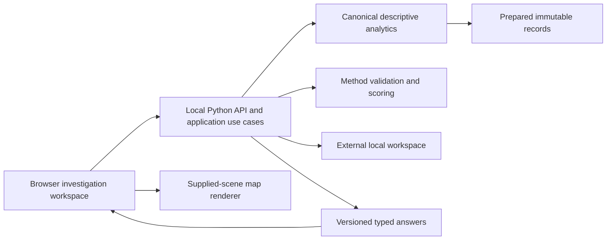

# Architecture

WISE_Platform is a local web application with a Python analytical backend and a TypeScript browser workspace. The first delivery target is Windows 11. One Python process serves the API and the built browser application. Node is needed to develop and build the browser application; a release containing those built assets is intended to need only its documented Python runtime and native dependencies.

## Current candidate and target application

The candidate implements CSV import, canonical descriptive queries, whole-incident selection, map/paths/variants, recorded-span and start-period charts, context and period comparison, one timing expectation, and durable investigations. M0 is historical foundation scope; the health contract still reports `stage: foundation` for compatibility, not as a current capability inventory. M1 remains incomplete: the transition matrix, the full linked-view and scoring journey, Windows human qualification and a measured supported capacity tier are open gates. [Current status](status.md) separates implementation from qualification; the [roadmap](roadmap.md) remains the target.

The current navigation has Data, Investigations, Compare, Expectation and Saved areas. An analyst can explore before defining any expectation. Queries bind source, interpretation and complete-incident populations across the implemented views; the matrix is a target view, not an available screen.




The [design perspectives](design.md), [requirements](requirements.md), [domain glossary](../GLOSSARY.md) and [decision records](adr/README.md) expand the target design. Consult [status](status.md) for implemented scope rather than treating target diagrams as completed capabilities.

## Ownership and dependencies

- **Application API:** workflow, task orchestration, source identity, local persistence, revision publication and recovery. HTTP handlers remain thin.
- **Browser application:** navigation, leading views, convenience state and typed user intents. It formats supplied values; it does not independently calculate analytical truth.
- **Canonical descriptive analytics:** a reusable Python package for representations, complete-case selection, graph/variant queries, context profiles and comparisons. It has no dependency on web, UI or database application layers. Execution adapters can use SQL only after parity with the canonical definitions.
- **Method library:** authoritative norm validation, applicability, measurement and WISE evaluation. Incident definitions must be qualified through its supported interface.
- **Flow library:** renders supplied versioned scenes and emits typed intents. It receives prepared scenes, not an unrestricted raw log.
- **Contracts:** one authoritative platform schema source generates Python models and TypeScript types. External library formats are referenced at their exact version rather than copied into a second independent specification.

Method and Flow have independent release lifecycles. This candidate composes exact vendored unreleased builds, identified by commit and hash in `vendor/manifest.json`; eligible released pins remain a release gate. `packages/analytics` contains the tested canonical implementation and depends only on the Python standard library and itself.

## Analytical contracts

A filter resolves complete incidents and retains all their source records. A displayed time range must say whether it selects incident starts or trims records; the first investigation workflow selects incident starts and preserves histories.

For comparison, freeze the parent population after retained filters and eligibility. A chosen predicate partitions that parent into included and excluded incidents. Event-presence predicates have an exact binary complement. Nullable measurements or scores also expose an unevaluable group, with reasons; missing evidence is not a successful result. A separately named outcome can require its own known-outcome population.

Target and comparator are semantic roles, independent of include/exclude or good/bad labels. Profile shares, percentage-point differences and concentration ratios display their denominators. Outcome rates condition on category membership and are different from category shares within an outcome group. Tiny support, zero baseline, empty comparator and parent-fixed attributes remain visible.

A transition matrix distinguishes distinct incident support, passage occurrences, usable lag and outgoing row-normalized frequency. Variants are actual ordered sequences, including repeats. Hiding visual elements never invents an observed direct relation. Context uses a named anchor/reducer; opening, latest and ever values are different definitions. Literal text such as “Unknown” remains distinct from unavailable data.

## Local state and coherent publication

Runtime source files, analytical artifacts, findings and diagnostics live in an external local workspace. The implemented adapter uses a versioned JSON manifest, content-addressed source bytes and preparation recipes, immutable definition/score-run files, and saved-revision files with head pointers. Writes use temporary files and atomic replacement; saved publication has a cross-process lock and expected-revision conflict checks. There is no workspace SQLite database in this candidate. Transactional metadata remains a possible future adapter, not an installed dependency or a completed migration path.

Analytical answers carry the relevant source/preparation/representation/population identities and query revision; definitions and score runs add their own identities. Browser coordinators guard publication against stale replies and retain a visibly coherent previous answer on selection/replacement failure. Aborting a browser request does not guarantee interruption of Python computation already executing in a worker thread.

Saved investigations retain selection recipes and exact membership, comparison roles, the description of a comparison's frozen parent (checked against its incidents), a named outcome, context policies, structured notes, pinned witnesses as bookmarks with their roles and optional score-run references. Reopening reconstructs preparations from preserved source bytes and checks their identities. Changed source bytes or incompatible state are refused. A refreshed source is a new reading: a saved question can be applied to it unsaved, with a review of what changed (source, column roles, clock, parent, selection; the comparison is made again), and saving adds a new revision while the earlier one stays and reopens. Automatic refresh and workspace migration are not implemented. Browser-local stages are presentation convenience state and are not included in a saved investigation or workspace backup. The application backs up a running workspace itself under the publication lock (only what it wrote, with a checksum manifest, written into a hidden folder that takes its name when complete) and restores a backup into another folder only after checking every file and reading its records and revisions back; the workspace keeps its identity, so a restore is a verified relocation. A stopped-workspace copy/restore is also exercised by the [capacity tool](capacity.md); power-loss recovery and migration are not qualified.

Local expectation authoring produces a versioned draft or reviewed definition with scope, endpoints, clock, target and missingness. Method evaluates it. Authoring and score-to-scene projection are separate: map marks must identify actual evaluated results, coverage and witnesses.

## Structure and evolution

```text
apps/api/       local host, application use cases and adapters
apps/web/       browser workspace
contracts/      schema source and generated boundary
tests/         cross-layer synthetic acceptance
docs/          product and developer documentation
```

Additional packages appear with real implementations. Avoid a separate service per module. Future object analysis, inference, prediction, shared workspaces and deployment adapters follow demonstrated needs and qualification. They do not change the first release’s local-data boundary.

The platform uses a noncommercial application licence. Independently licensed libraries and reused source retain their scoped terms and required notices. See the root licence and notice files.
