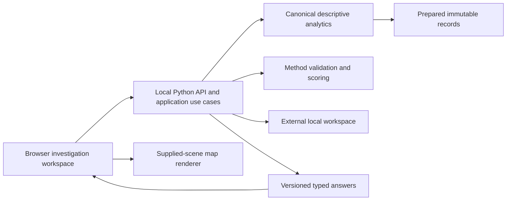
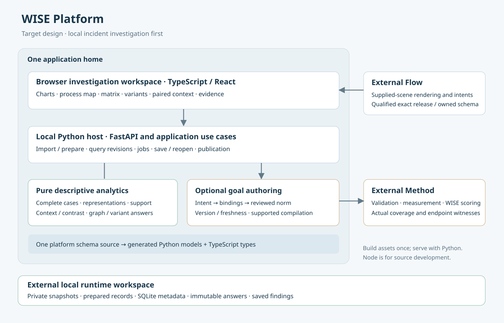

# Architecture

WISE_Platform is a local web application with a Python analytical backend and a TypeScript browser workspace. The first delivery target is Windows 11. One Python process serves the API and the built browser application. Node is needed to develop and build the browser application; a release containing those built assets is intended to need only its documented Python runtime and native dependencies.

## Current foundation and target application

M0 establishes the application entry, health contract, generated client boundary and development tests. It is not a complete incident-analysis application. Import, analytical queries, interactive investigation, scoring and durable findings belong to the M1 implementation and qualification gates in the [roadmap](roadmap.md).

The application has three user-facing areas: Data, Investigations and optional Expectations. An analyst can explore before defining any rule. A question keeps its source, interpretation, complete-incident population and comparison direction while the analyst switches between charts, map, matrix, variants and evidence.





The complete [design perspectives](design.md), [requirements](requirements.md), [domain glossary](../GLOSSARY.md) and [decision records](adr/README.md) expand this overview. These distinguish target design from implemented foundation.

## Ownership and dependencies

- **Application API:** workflow, task orchestration, source identity, local persistence, revision publication and recovery. HTTP handlers remain thin.
- **Browser application:** navigation, leading views, convenience state and typed user intents. It formats supplied values; it does not independently calculate analytical truth.
- **Canonical descriptive analytics:** a reusable Python package for representations, complete-case selection, graph/variant queries, context profiles and comparisons. It has no dependency on web, UI or database application layers. Execution adapters can use SQL only after parity with the canonical definitions.
- **Method library:** authoritative norm validation, applicability, measurement and WISE evaluation. Incident definitions must be qualified through its supported interface.
- **Flow library:** renders supplied versioned scenes and emits typed intents. It receives prepared scenes, not an unrestricted raw log.
- **Contracts:** one authoritative platform schema source generates Python models and TypeScript types. External library formats are referenced at their exact version rather than copied into a second independent specification.

Method and Flow remain independently released dependencies. Exact eligible release pins are an integration gate; M0 does not claim that analytical or rendering dependencies are ready. The descriptive analytics package is introduced with its first tested implementation, rather than as an empty directory.

## Analytical contracts

A filter resolves complete incidents and retains all their source records. A displayed time range must say whether it selects incident starts or trims records; the first investigation workflow selects incident starts and preserves histories.

For comparison, freeze the parent population after retained filters and eligibility. A chosen predicate partitions that parent into included and excluded incidents. Event-presence predicates have an exact binary complement. Nullable measurements or scores also expose an unevaluable group, with reasons; missing evidence is not a successful result. A separately named outcome can require its own known-outcome population.

Target and comparator are semantic roles, independent of include/exclude or good/bad labels. Profile shares, percentage-point differences and concentration ratios display their denominators. Outcome rates condition on category membership and are different from category shares within an outcome group. Tiny support, zero baseline, empty comparator and parent-fixed attributes remain visible.

A transition matrix distinguishes distinct incident support, passage occurrences, usable lag and outgoing row-normalized frequency. Variants are actual ordered sequences, including repeats. Hiding visual elements never invents an observed direct relation. Context uses a named anchor/reducer; opening, latest and ever values are different definitions. Literal text such as “Unknown” remains distinct from unavailable data.

## Local state and coherent publication

Runtime source files, databases, analytical artifacts, findings and diagnostics belong in a selected workspace outside program files and tracked source. SQLite metadata and immutable analytical files are planned storage adapters; their transaction, backup and compatibility behavior must be qualified.

Every answer carries source/preparation/representation/population/definition identity and a query revision. A single publication boundary prevents stale success, error or pagination replies from replacing the current question. A failed query leaves a visibly coherent previous answer and offers retry/cancel.

Saved investigations retain exact populations, comparison roles, context policies, definitions, notes and complete evidence. Norm and score references are optional. Unscored exploration can be saved and reopened. Refreshing a changed source creates a new revision rather than silently changing an existing finding.

Local expectation authoring produces a versioned draft or reviewed definition with scope, endpoints, clock, target and missingness. Method evaluates it. Authoring and score-to-scene projection are separate: map marks must identify actual evaluated results, coverage and witnesses.

## Memory and capacity

Prepared data is currently held in the local Python process, so its memory is a product property. [Decision 0006](adr/0006-bounded-memory-prepared-data.md) (proposed) sets the target. Prepared records will hold repeated values once and compute derivable values when read. Sources will be streamed into the workspace and read in one pass. Retained data and each operation's estimated peak will share one byte budget, and work that cannot fit will be refused before it reads. A declared capacity tier will publish measured limits. A columnar analytical file or query engine follows only when a measured tier needs it and exact parity holds.

## Structure and evolution

```text
apps/api/       local host, application use cases and adapters
apps/web/       browser workspace
contracts/      schema source and generated boundary
tests/         cross-layer synthetic acceptance
docs/          product and developer documentation
```

Additional packages appear with real implementations. Avoid a separate service per module. Future object analysis, inference, prediction, shared workspaces and deployment adapters follow demonstrated needs and qualification. They do not change the first release’s local-data boundary.

The platform uses a noncommercial application licence. Independently licensed libraries and reused source retain their scoped terms and required notices. See the root licence and notice files.
