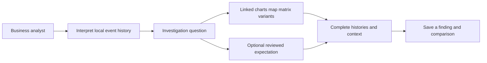
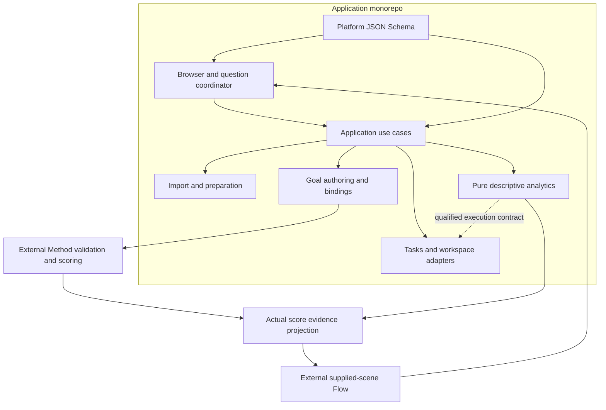
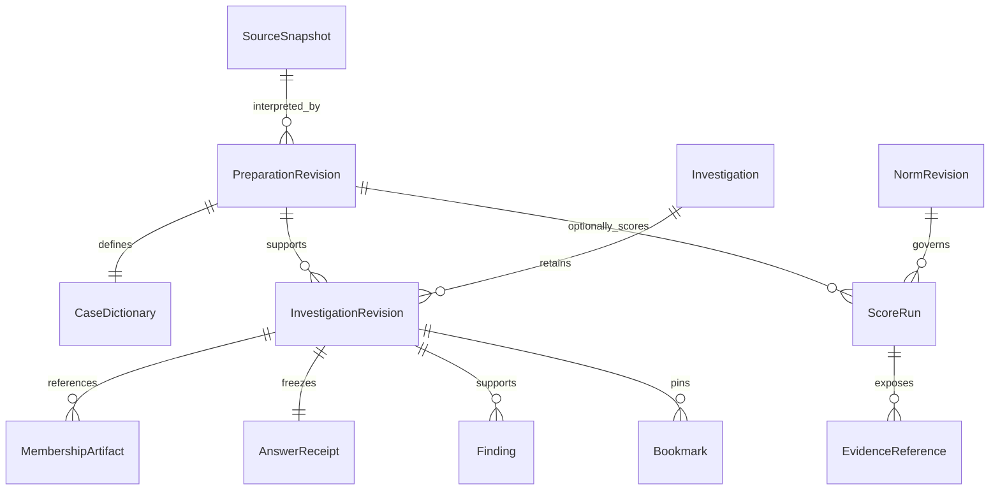
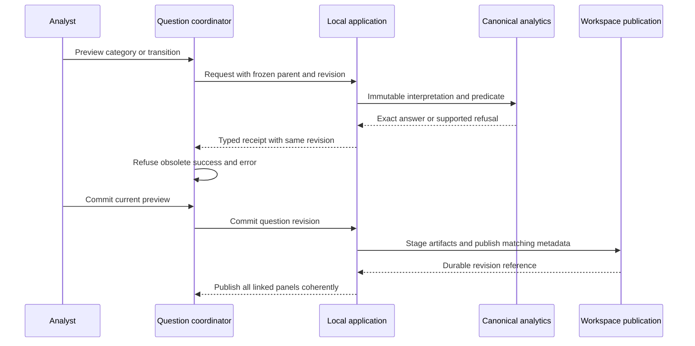
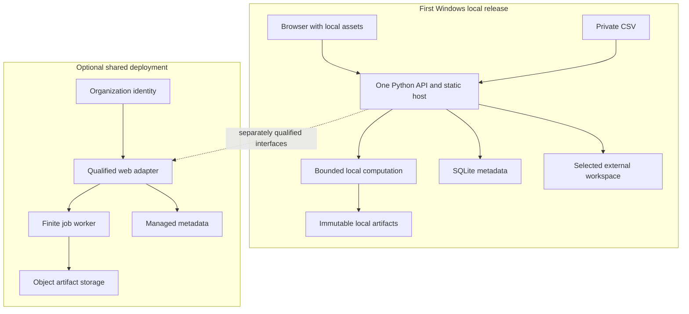
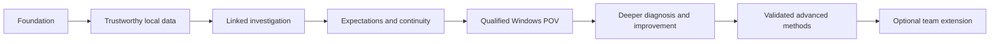

# Design perspectives

This is the target design for staged implementation. The current executable scope remains M0: local host, generated health boundary and foundation screen. The [requirements](requirements.md) and [roadmap](roadmap.md) define what must be qualified before the incident POV is complete.

## Business and customer perspective

The analyst's durable unit is an investigation. The three entry areas are Data, Investigations and optional Expectations. Charts can lead an investigation as naturally as a process map. Selecting a group, time cohort, duration tail, transition or variant refines complete incidents and retains their histories. No expectation is necessary to open or save a question.

The first useful journey combines delay-tail inspection, reassignment/reopening review, absent-resolution coverage and paired context comparison. Later customer journeys add purchase-to-pay control evidence, loan paths, improvement pilots and object perspectives. These expand the same evidence model; they do not create independent dashboards with incompatible populations.

## Logical modules and languages

Python contains the API/application use cases, canonical descriptive analytics and adapters to Method/storage. TypeScript/React contains navigation, charts, linked view state and typed user intents. JSON Schema is the platform boundary authority, with generated Python models and TypeScript types. Schema validation establishes structure; independent analytical fixtures establish semantics.

| Module | Owns | Must not own |
| --- | --- | --- |
| API/application | Import workflows, tasks, query revisions, publication, findings, persistence, export and authoring workflows | Competing analytical definitions in HTTP handlers |
| Pure analytics | Complete-case predicates, named representations, graphs, variants, context, contrast, units and support | Web/UI/database framework imports |
| Execution adapters | Qualified execution over immutable prepared data; explicit policy/version identity | A second denominator, ordering or missingness policy |
| Browser | Linked views, accessible intents and presentation state | Re-scoring, classification or denominator inference |
| Goal authoring | Intent, operational bindings, review, version/freshness and supported norm compilation | A second evaluator or invented affected counts |
| Method dependency | Supported norm validation, applicability, raw measurement and WISE scoring | Browser interaction or local workspace orchestration |
| Flow dependency | Owned scene format, layout/rendering/detail and emitted intents | Raw-log queries, covert case filtering or scoring |
| Persistence adapters | Metadata and immutable artifacts with migration/restore qualification | Silent reinterpretation of saved definitions |

A module earns a folder with its first tested responsibility. The pure analytics package is introduced with the first real investigative slice, rather than as an empty shell. Method and Flow stay pinned external releases; the platform does not absorb their histories or maintain a competing scene schema. Current foundation dependencies do not certify those future integrations.

## Information and domain perspective

A SourceSnapshot identifies immutable source bytes and observation cutoff. PreparationRevision records interpretation and establishes a CaseDictionary. An InvestigationRevision binds source, preparation, representation, population, policies and answers. NormRevision and ScoreRun enrich it optionally. Findings/bookmarks pin revisions and evidence; presentation state can be reset independently.

Case identifiers from another dictionary cannot be reused just because internal integers match. Artifact paths are relative to workspace identity; source, dictionary, policy and format checks qualify relocation. A new source import or changed preparation creates a new revision rather than altering an old finding.

SQLite metadata and immutable analytical files are planned local storage adapters. Parquet/JSON can carry prepared data, membership and answers. A query adapter such as DuckDB is adopted only after exact semantic parity and measured benefit. Database choice does not make a definition canonical.

## Analytical perspective

Retained filters and eligibility produce a declared frozen parent P. A predicate yields kept A and removed B, plus U when genuinely unevaluable. Recorded-event presence under a reviewed mapping has an exact binary complement; a nullable interval or unevaluated score cannot be treated that way. A separately defined outcome has its own known population K.

Target/comparator roles remain separate from literal keep/remove. Reversing roles changes comparison direction; inverting the predicate changes membership labels; rebasing intentionally creates a new parent. A profile inspection must retain the comparator and allow a counterexample rather than collapsing to one side.

Every measure carries raw support, unit, denominator, availability and direction. Composition share, percentage-point difference and composition ratio differ from outcome rate/lift. Zero reference support is a named unavailable state, not infinity or an invented epsilon. Tiny support, empty groups, missing categories and parent-fixed fields remain visible. Shared numeric bins are fixed from P for comparable distributions.

Opening context is anchored to the named opening event and preserves an unavailable value there; it cannot substitute the first later nonempty value. Latest and ever are separately qualified policies. Overlapping ever-membership is not a disjoint pie. Literal text such as "Unknown" remains distinct from a missing value.

Map/matrix/variants use one ordered mapped representation. Timestamp ties use a declared authority and original source position. Missing activity labels stay in raw evidence while their mapped omission/gaps are disclosed. Repeated passages differ from unique incident support. Outgoing passage frequency differs from cohort case share. Lag mean, median and usable support remain separate from active working time. Hiding an activity does not invent a recorded adjacency between its neighbors.

The input/output contract family grows with implemented slices: source/preparation manifests, population predicates, query receipts, typed graph/variant/profile answers, task status and investigation serialization. Each answer includes format/version, request identity, query revision, source/preparation/dictionary identity, policy/implementation versions, memberships/supports and availability. The health schema is the only currently implemented boundary. Future contracts are reviewed alongside exact acceptance examples before publication.

## Runtime and state perspective

One coordinator publishes linked answers under one revision. Preview does not silently commit; undo restores a previous immutable revision. A failed new query can leave the previous answer visible only with an explicit pending/error indication. Stale errors are fenced as strictly as stale successful responses and pagination.

Tasks include source, interpretation, query, measure and optional norm identity. Cancellation is cooperative, but publication remains fenced even if computation completes after cancellation. Cache keys include the same meaning-bearing identities. Budgets and memory limits are measured; a count-based cache limit alone is insufficient.

Authoring produces a reviewed versioned norm. Method performs the evaluation. A separate result-to-scene projection carries actual affected membership, evaluated support, coverage and witnesses. Example reference marks, context highlights and actual score marks are distinguishable. A whole-rule count displayed at several anchors cannot be added as local counts.

## Deployment and private-data perspective

The first release binds loopback deliberately and serves built browser assets through the Python process. Node is a developer/build dependency. Setup may acquire approved dependencies; analysis uses local records/assets offline. A separate database server is unnecessary for the first measured tier. Windows locking, Unicode paths, interruption, rename/publication behavior, runtime/native wheels and backup/restore require actual qualification.

Source files, databases, artifacts, definitions and findings belong in a selected workspace outside program files. Diagnostics must avoid record contents by default and preview any included information. No remote assistant, telemetry or cloud service is required. Shared hosting needs a separate decision about identity, tenancy, residency, concurrency and costs. Azure App Service or Container Apps/jobs are candidate adapters, not provisioned resources or P0 dependencies; orchestration complexity is justified only by measured needs.

## Evolution and assurance perspective

M0 establishes the host and contract/build boundary. M1a establishes reliable interpretation and semantics through complete slices. M1b links charts, process views, paired context and evidence. M1c adds optional reviewed scoring and durable continuity. M1d qualifies download/setup and the complete Windows journey. Richer timing/models/improvement precede linked objects/scenarios/prediction and optional team capabilities.

Build fresh against roadmap outcomes. Prior code can be reused only where supported meaning, rights and tests fit the new design. Old workspace formats are not compatibility obligations. Historical sources remain protected until useful capabilities have replacements and a reviewed preservation/retirement plan exists. Application updates and workspace migrations are separate operations.

Acceptance combines independent synthetic expectations, schema/runtime validation, coherent browser interaction, failure/recovery tests and actual Windows installation. Synthetic reference arithmetic is not passing product analytics; a successful health response is not a completed incident journey. See [testing](testing.md) and [architecture requirements](requirements.md).

## Score populations and applicability

A score displayed for a selected subpopulation is selected from an existing run over its explicitly named scored population. It is never silently recalculated after a chart/filter selection. Evaluating a subset is a new run with its own population, calibration, norm and implementation identity; the interface names that change. Population-dependent calibration can make the two operations differ.

Platform predicates select complete cases for descriptive investigation. A norm's scope uses Method's supported selection grammar. Authoring compiles reviewed scope into that norm; the platform never independently determines normative applicability. Applicable, out-of-scope, unevaluated and affected states come from actual Method results and reasons.

Score answers expose raw measurements and graded values. For supported lag definitions, target and saturation width are separate inputs; values above zero are affected as defined by Method. Descriptive true/false/unevaluable threshold queries remain a separate contract. Missing-response behavior and occurrence pairing are explicit supported choices, not hidden defaults.

Map activities keep stable positions across an investigation's revisions until the analyst requests a new arrangement. A qualified union-layout/scene strategy preserves comparable positions during preview and undo. Filter chips keep readable activity/attribute names even when those elements disappear from the selected scene.
